# Road accidents in France, 2005-2025: who gets seriously hurt, where and why

An end-to-end analysis of the 1.34 million injury accidents recorded by the French police between 2005 and
2025 (3.0 million people involved), from the raw official files to maps, statistical models, machine
learning and an interactive dashboard.

**Author:** Mouataz Bounit

**[Interactive dashboard](https://bmbmouataz.github.io/road-accidents-france/site/dashboard.html)** · **[Full report](https://bmbmouataz.github.io/road-accidents-france/site/report.html)** ·
**[Interactive map](https://bmbmouataz.github.io/road-accidents-france/figures/04_geography/interactive_map.html)**
(online, or locally: see [how to open them](#how-to-view-the-dashboard-and-the-report))

## The question

> Given that an injury accident has happened, which factors make it more likely that a person is
> seriously injured or killed?

The data only covers accidents with at least one injured person, so this project studies the **severity**
of accidents, not the risk of having one. Exploration, maps and models all point to this one question.

## Key findings

**1. Deaths fell by 38% between 2005 and 2025, but the decline stopped in 2013.** 5,543 people were killed in
2005, 3,427 in 2013 and 3,442 in 2025. The 2020 lockdowns are the only real dip since.

<p align="center">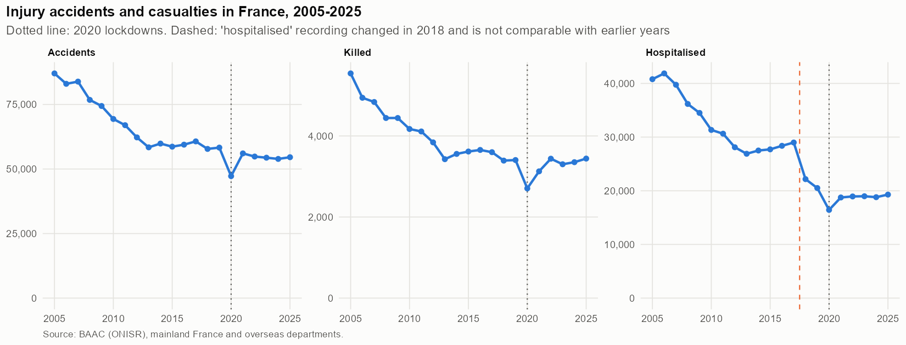</p>

**2. The mode of transport decides the outcome.** Between 2019 and 2025, 37% of motorcyclists, 33% of
pedestrians and 28% of cyclists involved in an accident were killed or hospitalised, against 12.5% of car
occupants. Car deaths have halved since 2005, while cyclist deaths rose by 32%.

<p align="center">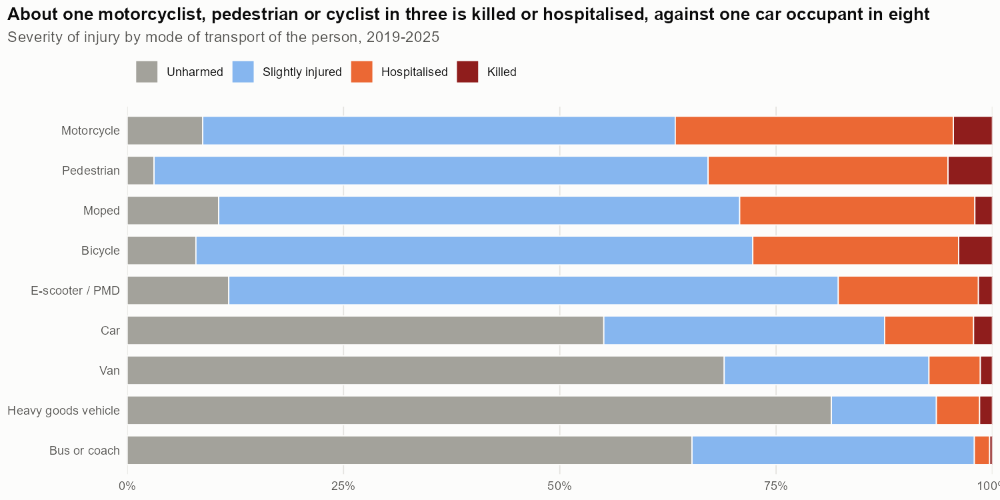</p>

**3. Who you collide with matters as much as how you travel.** Hit by a heavy goods vehicle, 64% of
pedestrians and 55% of cyclists are killed or hospitalised. A motorcyclist who crashes alone is as badly
hurt as one hit by a lorry (47%).

<p align="center">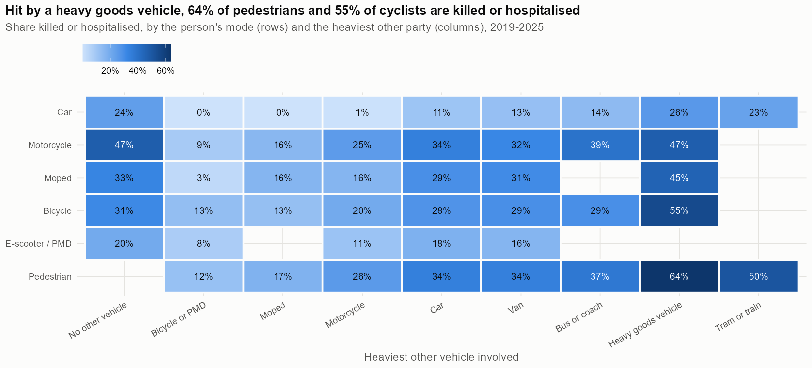</p>

**4. Night, rural roads and dark roads.** Between 3 and 5 a.m., an accident kills 2 to 3 times as often as
at 5 p.m. On departmental roads outside built-up areas there are 14.5 deaths per 100 accidents, against 4.3
on the same roads in town. At night on unlit roads, the share of people killed is 2.7 times the daylight
level. Nearly four road deaths in five are men.

<p align="center">
  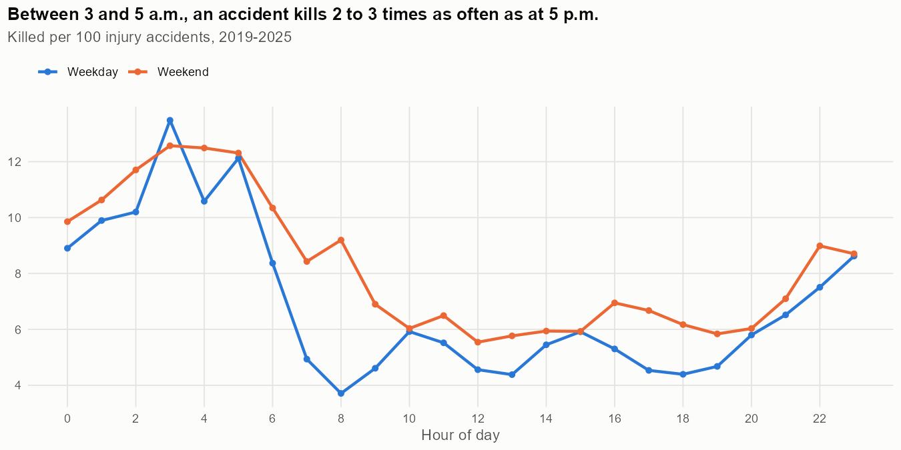
  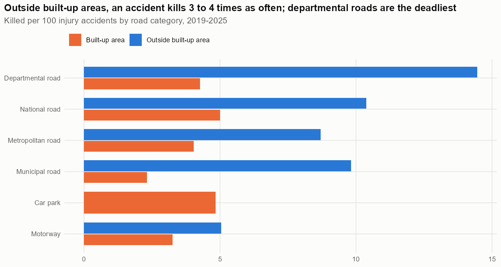
</p>

**5. Where accidents happen is not where people die.** Paris has the most accidents per inhabitant, but an
accident there kills 0.8 people per 100, against 17.6 in Haute-Marne. Per million inhabitants, road deaths
range from 14 in Hauts-de-Seine to 115 in Haute-Marne (mainland average: 48).

<p align="center">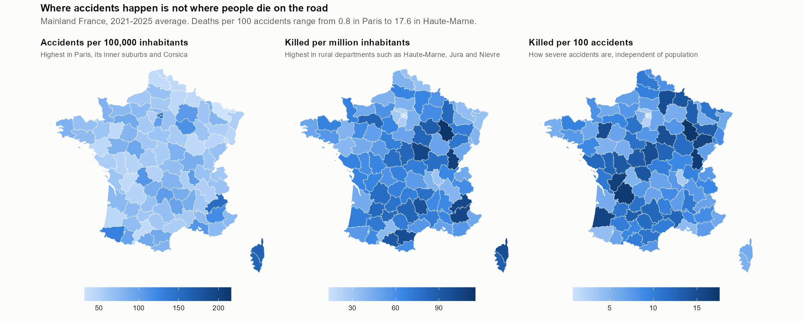</p>

**6. With everything adjusted, the person's mode, protection and age dominate.** A logistic regression on
841,052 people involved in accidents between 2019 and 2025 gives the odds of being killed or hospitalised
for each factor, all others held equal. Standard errors are clustered by accident, since people in the same
crash are not independent (clustered errors are 11% wider than naive ones, in median).

| Factor (reference) | Odds ratio [95% CI] |
|---|---|
| Pedestrian (car occupant) | 10.0 [9.8-10.3] |
| Motorcyclist (car occupant) | 6.5 [6.4-6.6] |
| Belt or helmet not worn (worn) | 4.3 [4.1-4.5] |
| Aged 75 or more (35-44) | 3.3 [3.2-3.4] |
| Hit by a heavy goods vehicle (by a car) | 2.7 [2.6-2.8] |
| Outside a built-up area (inside) | 2.5 [2.4-2.6] |
| Night, 22h-6h (10h-16h) | 1.6 [1.5-1.6] |
| No street lights at night (daylight) | 1.2 [1.2-1.3] |
| Man (woman) | 1.05 [1.03-1.06] |

Two raw contrasts shrink once the other factors are held equal. Darkness on unlit roads, which multiplied
the share killed by 2.7, keeps an odds ratio of 1.2: most of its effect came from night-time and rural
roads. And men, who are 78% of the dead, are barely more fragile than women once involved in the same
accident (1.05): the difference comes from exposure and behaviour, not from the outcome of a given crash.
The model reaches an in-sample AUC of 0.83.

<p align="center">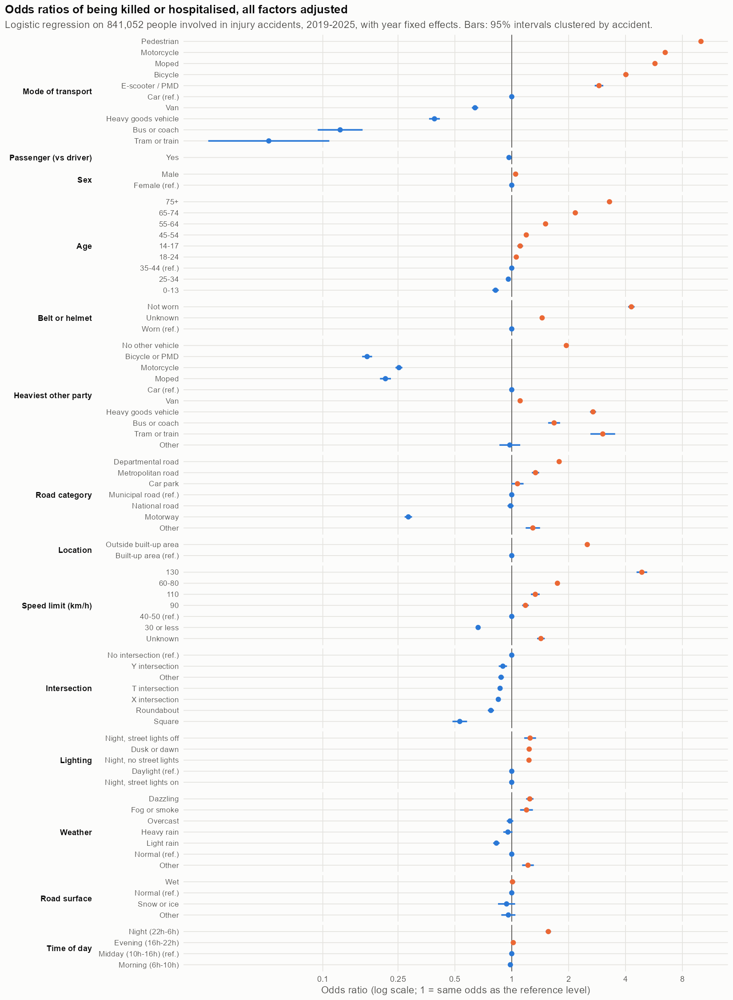</p>

Interactions are significant: leaving built-up areas raises the risk for every mode, but most in absolute
terms for pedestrians (32% to 50%) and cyclists (20% to 37%); and age weighs more on pedestrians (+24 points
between 35-44 and 75+) than on belted car occupants (+12 points).

<p align="center">
  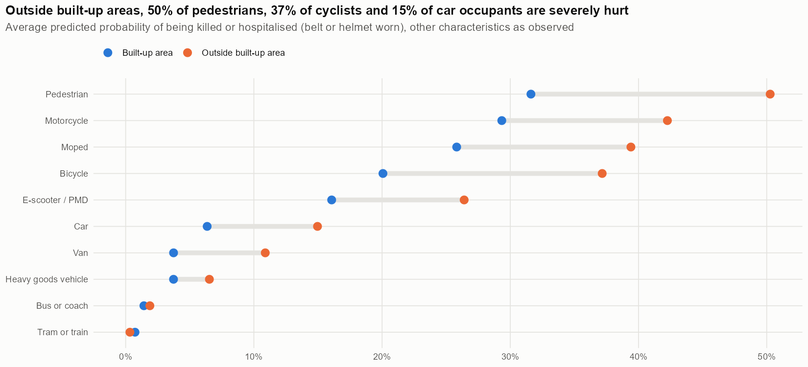
  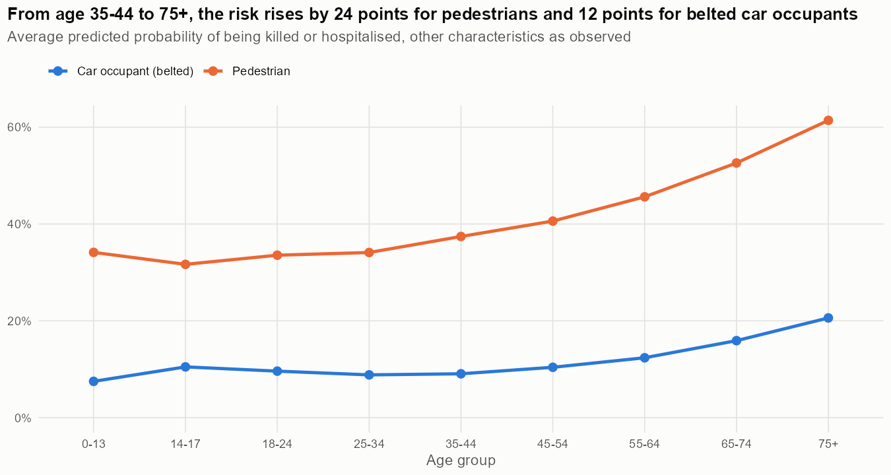
</p>

Odds ratios of correlated variables must be read together: the 130 km/h limit has an odds ratio of 4.9,
but it only occurs on motorways, whose own odds ratio is 0.28. The model uses only what is known before the
impact (no collision type, obstacle or impact point). "Belt or helmet not worn" may also be partly a
recording effect, for instance if equipment is checked more carefully when someone is badly hurt.

**7. Machine learning ranks people a little better, and the crash itself decides a lot.** Trained on
2019-2022, tuned on 2023 and tested on 2024-2025, XGBoost reaches a ROC-AUC of 0.846 and a PR-AUC of 0.555
(prevalence 18.3%), against 0.825 and 0.516 for the penalised logistic regression and 0.669 for the
"rate by mode" rule. The gain over the logistic regression is small but certain (+0.020; 95% interval from
a bootstrap of whole accidents: 0.020 to 0.022). Adding the crash variables (collision type, obstacle,
impact point, manoeuvre) raises the ROC-AUC to 0.869. All models are well calibrated.

| Model, test years 2024-2025 | ROC-AUC [95% CI] | PR-AUC | Brier |
|---|---|---|---|
| Baseline: rate by mode | 0.669 [0.666-0.673] | 0.308 | 0.139 |
| Penalised logistic regression | 0.825 [0.823-0.827] | 0.516 | 0.116 |
| Random forest | 0.843 [0.841-0.844] | 0.548 | 0.111 |
| **XGBoost** | **0.846 [0.844-0.848]** | **0.555** | **0.111** |
| XGBoost + crash variables | 0.869 [0.867-0.871] | 0.600 | 0.104 |

<p align="center">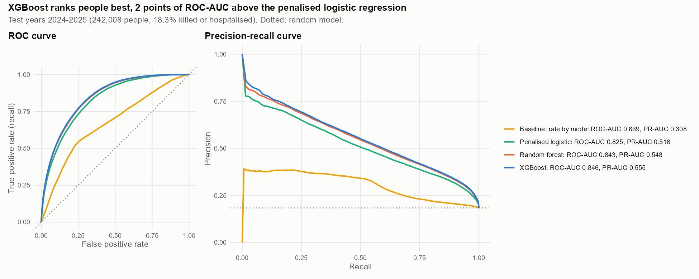</p>

The global score hides a limit: within a single mode, severity is much harder to predict for vulnerable
road users (ROC-AUC 0.73 for pedestrians, 0.68 for e-scooter riders) than for car occupants (0.86), and the
model misses most severe cases among e-scooter riders. SHAP values rank the mode first, then the heaviest
other party, the road and the location.

<p align="center">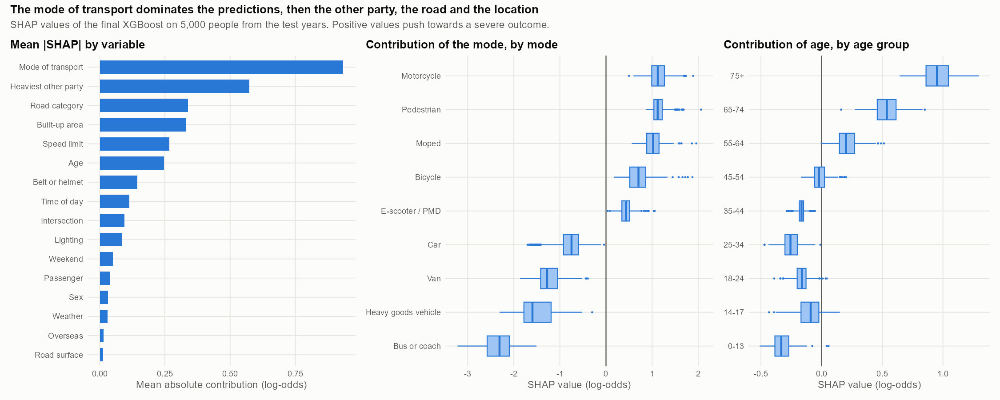</p>

All figures are in [`figures/`](figures/) and the numbers behind them in [`results/`](results/). The
[report](docs/site/report.html) explains every step and discusses the limits: only injury accidents are
recorded, there is no exposure data (kilometres travelled), and the associations are not causal effects.

## What changed from the first version

This project started as a course notebook. Rebuilding it from the raw files showed several problems:

| First version | What was wrong | Now |
|---|---|---|
| Users and vehicles joined on the accident id only | Every person was paired with every vehicle of the accident: 5.7 million rows instead of 3.0 million (+90%), so all counts were inflated | Each person linked to their own vehicle (`id_vehicule` from 2019, vehicle letter before) and checked by six automatic consistency tests |
| Severity compared over 2005-2023 | "Hospitalised" is recorded differently from 2018 and is not comparable (ONISR warning) | Severity rates and models on 2019-2025, breaks marked on every chart |
| Department code cut to two characters | Corsica (`2A`, `2B`) became missing and all overseas departments merged into `97` | Codes rebuilt for both formats |
| Hour of the accident fixed by hand for one count | The time format changes in 2019 (`1930` then `19:30`) | Parsed for both formats |
| Raw counts on the maps | Counts mostly reflect population | Rates per inhabitant (INSEE) and per accident |
| 2005-2023, files read from a local folder | Not reproducible | 2005-2025 downloaded from data.gouv.fr by a script |

The data quirks and how each one is handled are listed in [`data/README.md`](data/README.md).

## Project structure

```
R/
  00_utils.R              settings, theme, palette, helpers
  00_model_data.R         modelling table shared by parts 5 and 6
  01_download.R           BAAC 2005-2025 (data.gouv.fr), INSEE populations, department boundaries
  02_harmonise.R          one schema for 21 years of changing formats
  03_quality.R            missing values, duplicates, orphans, invalid values  -> results/quality_checks.csv
  04_features.R           correct joins, labels, age, period, vehicle groups, heaviest other party,
                          target variable, consistency tests                      -> data/final/
  05_eda.R                exploratory analysis                                    -> figures/03_eda
  06_geography.R          department rates, maps, interactive leaflet map        -> figures/04_geography
  07_logistic_regression.R  odds ratios with clustered errors, interactions,
                          average predicted probabilities                       -> figures/05_model
  08_machine_learning.R   baselines, glmnet, random forest, XGBoost; chronological split
  09_evaluation.R         test metrics with accident bootstrap, ROC/PR, calibration,
                          confusion matrices, errors by group, SHAP              -> figures/07_evaluation
  10_dashboard_data.R     small aggregated tables for the dashboard               -> site/data
site/
  dashboard.qmd           Quarto dashboard (Observable JS, filters run in the browser)
  report.qmd              full report, parts 1 to 9
index.qmd, _quarto.yml    website rendered to docs/ (GitHub Pages)
data/README.md            sources, licences, definitions, known breaks
figures/  results/  models/
run_all.R                 runs every R step in order
```

## How to run

Requires R 4.4 or later and [Quarto](https://quarto.org) 1.4 or later.

```bash
Rscript install_packages.R
Rscript run_all.R          # about 45 minutes on 12 cores; downloads 470 MB on the first run
Rscript run_all.R 05 06    # only some steps
quarto render              # builds the website (dashboard, report) into docs/
```

If Quarto does not find R, point it to `Rscript` first, for example in PowerShell:
`$env:QUARTO_R = "C:/Program Files/R/R-4.4.2/bin/Rscript.exe"`.

## How to view the dashboard and the report

Browsers block the dashboard's JavaScript (Observable JS) when the page is opened directly from the disk,
so it has to be served by a local web server.

- **On Windows:** double-click [`view_dashboard.bat`](view_dashboard.bat). It starts the server and opens
  the dashboard in the browser; close its window to stop it.
- **Elsewhere:** run `python -m http.server 8000` in the `docs/` folder, then open
  <http://localhost:8000/site/dashboard.html> or <http://localhost:8000/site/report.html>.

Once the repository is on GitHub, enabling GitHub Pages on the `docs/` folder publishes the same pages
online, and the dashboard opens with a simple link.

## Contents

| Part | Content | Where |
|---|---|---|
| 1. Data | Context, sources, the four tables, definitions | [`data/README.md`](data/README.md), report section 1 |
| 2. Data engineering | Harmonisation, quality checks, joins, features | `R/01` to `R/04`, report section 2 |
| 3. Exploratory analysis | Time, conditions, roads, vehicles, users, severity | `R/05`, `figures/03_eda` |
| 4. Geography | Rates by department, change over time, interactive map | `R/06`, `figures/04_geography` |
| 5. Statistical model | Logistic regression, odds ratios with errors clustered by accident, interactions | `R/07`, `figures/05_model` |
| 6. Machine learning | Baselines, penalised logistic regression, random forest, XGBoost; train 2019-2022, validation 2023, test 2024-2025 | `R/08` |
| 7. Evaluation | ROC-AUC and PR-AUC with bootstrap intervals, calibration, confusion matrices, errors by group, SHAP | `R/09`, `figures/07_evaluation` |
| 8. Dashboard | Quarto dashboard filtered by years, department and mode | `site/dashboard.qmd`, `R/10` |
| 9. Report | Full write-up, discussion and limits | `site/report.qmd` |

## Data and licence

Accident data: ONISR, *Bases de données annuelles des accidents corporels de la circulation routière*,
data.gouv.fr, Licence Ouverte 2.0. Populations: INSEE. Boundaries: IGN via france-geojson. Details in
[`data/README.md`](data/README.md).
